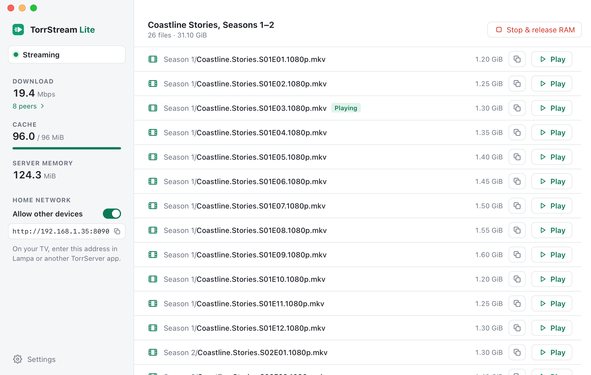

#  TorrStream Lite

Stream torrents to your Mac or your TV without saving anything to disk. TorrStream Lite keeps the video in a small RAM cache and frees it as soon as you stop.

- **Paste a magnet link or a torrent URL, or drop a .torrent file on the window,** and play any file right away in VLC or IINA, or in another player through its stream address
- **Light on memory, nothing on disk:** the video goes through a 96 MiB cache, whatever the size of the torrent
- **Seek anywhere:** only the parts you watch are downloaded
- **Watch on your TV** with Lampa or another app made for [TorrServer](https://github.com/YouROK/TorrServer). TorrStream Lite answers them like TorrServer does, on the same port
- **See the download** as it happens: speed, cache use and every connected peer
- Light and dark appearance

<picture>
  <source media="(prefers-color-scheme: dark)" srcset="docs/images/screenshot-dark.png">
  
</picture>

Website: [andeliseev.github.io/torrstream-lite](https://andeliseev.github.io/torrstream-lite/)

## Download

Get the latest version from the **[Releases page](https://github.com/andeliseev/TorrStreamLite/releases/latest)**. What changed in each version is in the [changelog](CHANGELOG.md).

| System | File |
| --- | --- |
| macOS 12 or later, Apple Silicon | `TorrStream-Lite-<version>-macos-arm64.dmg` |
| Keenetic router (ARM64 with Entware), experimental | `TorrStream-Lite-<version>-linux-arm64.tar.gz` |

Each file has a `.sha256` checksum next to it.

### First launch

TorrStream Lite isn't notarized by Apple yet (that takes a paid Apple developer membership), so the first time you open it macOS says *"Apple could not verify 'TorrStream Lite' is free of malware that may harm your Mac or compromise your privacy."* To open it anyway:

1. Drag **TorrStream Lite** from the disk image to **Applications**, and open it from there.
2. When the message appears, click **Done**.
3. Open **System Settings → Privacy & Security** and scroll down. Next to *"TorrStream Lite" was blocked to protect your Mac*, click **Open Anyway**. The button shows for about an hour after you tried to open the app.
4. Click **Open Anyway** again and confirm with your password or Touch ID.

macOS remembers this for the copy you allowed; a new version asks again. If you use Terminal, this command does the same:

```sh
xattr -dr com.apple.quarantine "/Applications/TorrStream Lite.app"
```

The app is open source, and you can check that a download is the one GitHub built: `shasum -a 256` on the file must print the same value as its `.sha256` file.

If macOS asks whether TorrStream Lite may find devices on your local network, click **Allow**. Without it, your TV can't connect.

## Watching on your Mac

1. Open **TorrStream Lite**, paste a magnet link or a torrent URL and click **Add**. Or drop a .torrent file on the window, or press ⌘O.
2. Click **Play** next to a file. It opens in VLC or IINA. For another player, click the copy button next to it and open that address in the player.
3. When you're done, click **Stop & release RAM**. One torrent plays at a time, so stop it before you add the next one.

**Download** in the sidebar shows the connected peers and their speeds. **Settings** (⌘,) has the home network port, the cache size, the appearance (System, Light or Dark), cache details and information about the app.

## Watching on your TV

1. Keep the Mac awake and on the same home network as the TV.
2. In the sidebar, under **Home network**, turn on **Allow other devices**. The app shows the address to use, for example `http://192.168.1.35:8090`.
3. In Lampa, open **Settings → TorrServer** and enter that address. Other TorrServer apps have a similar setting.
4. Choose a torrent in Lampa and play it.

**Allow other devices** is off by default. While it's on, anything on your home network can add, play and stop torrents without a password, including web pages open on its devices, so turn it off when you're done watching. Nothing is reachable from the Internet, and no port forwarding is needed.

The address uses port 8090, like TorrServer. If TorrServer itself runs on the same Mac, choose another port in **Settings**.

## Memory

TorrStream Lite started as a streaming server small enough to run on a home router, and the Mac app keeps that design:

- **One cache, always the same size.** The video goes through a single block of RAM, 96 MiB unless you choose 192 or 256 MiB in **Settings → Cache**, whether the torrent is 1 GB or 100 GB. It's taken when you add a torrent and given back when you stop it, quit, or after five minutes with nothing playing.
- **More cache, if you like.** A bigger cache keeps more of the video around where you're watching: smoother playback on slow torrents and quicker seeks back. A change applies to the next torrent you add.
- **Only what you watch.** The app downloads the part your player asks for and a little ahead of it, never the whole file. Seeking back further than the cache holds downloads that part again.
- **Measured:** in our tests the whole server used about 110 MiB while streaming and about 15 MiB after Stop. The window and your video player use memory of their own.
- **No disk at all:** no video files, no cache files, no history.

## Privacy

TorrStream Lite runs on your computer. It has no account, no analytics and no servers of its own.

- **Torrent traffic:** like any torrent app, it connects to the trackers and peers of the torrent you add, and to the DHT network that helps find peers. They see your IP address.
- **Torrent URLs:** when you add a torrent by its URL, the app downloads the .torrent file from that address.
- **Nothing is kept:** the video is released when you stop the torrent or quit. Watched positions from TV apps last only until the torrent is stopped. When nothing has played for five minutes, or a TV app drops the torrent, the app keeps only its link in memory, so the TV app can play it again; Stop, another torrent or quitting forgets it.
- **Settings:** the Mac app saves only the home network switch and port, the cache size, the appearance, and the window's size and position.

Read the full [privacy policy](https://andeliseev.github.io/torrstream-lite/privacy.html).

## What it doesn't do

- **Play several torrents at once.** One torrent runs at a time, with the whole cache to itself.
- **Convert video.** Files play as they are, so your player must support their format. VLC and IINA play almost anything.
- **Upload to other peers (seed).** It only downloads, so it doesn't help others finish the torrent, and it doesn't suit private trackers that require you to upload.
- **Search for torrents.** Bring a magnet link or a .torrent file, or search in Lampa.
- **Work as a DLNA media server.** A TV's own media player can't browse it; use Lampa, another TorrServer app, or a player with the stream address.
- **Play a few rare torrents:** ones whose pieces don't fit three times in the cache (larger than 32 MiB with the default 96 MiB cache, 64 MiB with a bigger one), and ones made only in the newer BitTorrent v2 format. Hybrid v1 and v2 torrents play.
- **Run on Intel Macs.** The Keenetic router build hasn't been tested on a router yet.

## Building from source and contributing

The server is written in Rust on a modified [librqbit](https://github.com/ikatson/rqbit) torrent engine, and the Mac app is a small Swift window around it. TorrStream Lite is an independent project inspired by TorrServer; it doesn't contain TorrServer's code. To build it yourself, run the tests or publish a release, see [docs/development.md](docs/development.md). How it works inside is in [docs/](docs/README.md), and the Keenetic setup in [docs/router.md](docs/router.md).

Bug reports and pull requests are welcome. To report a security problem, see [SECURITY.md](SECURITY.md).

## License

[MIT](LICENSE), © 2026 Andrei Eliseev. The modified librqbit engine stays under Apache-2.0; see the [third-party notices](THIRD_PARTY_NOTICES.txt).
