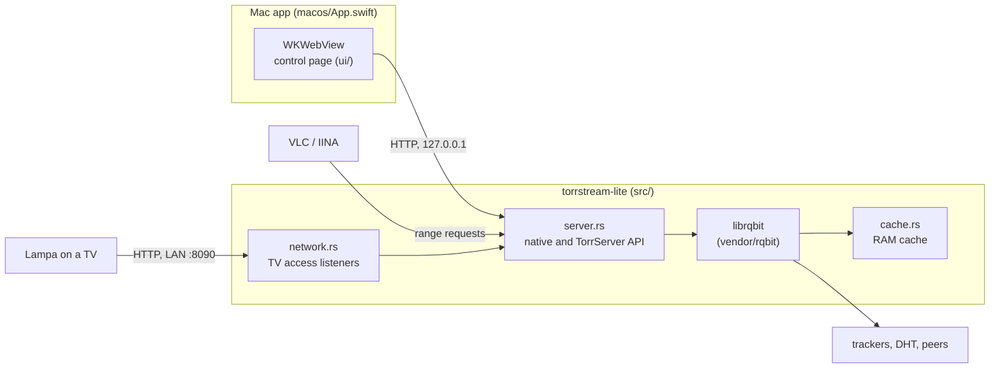

# Architecture

TorrStream Lite is one Rust process: an HTTP server ([axum](https://github.com/tokio-rs/axum)) in front of a modified [librqbit](https://github.com/ikatson/rqbit) torrent engine whose only storage is a fixed RAM cache. The Mac app is a Swift window with a WKWebView. It starts the server on a free loopback port and shows its control page, which is static HTML/CSS/JS compiled into the server binary.

## Rust modules

| Module | Responsibility |
| --- | --- |
| `main.rs` | Command-line options, the engine session (upload off, DHT without persistence, connection limits), server start and graceful shutdown |
| `server.rs` | Routes and browser-origin checks, adding and stopping the one active torrent, range streaming, preload, the TorrServer-compatible routes, releasing an idle torrent |
| `cache.rs` | `RamFactory` and `RamStorage`: one anonymous memory mapping split into piece slots, reserved before network requests, least-recently-used eviction |
| `network.rs` | TV access (in the app: **Home network → Allow other devices**): finds the Mac's private LAN addresses and runs one listener per address on the TV port, checked again every 3 s |
| `range.rs` | Parses a single HTTP byte range |
| `memory.rs` | The server's resident memory, shown in the app |

Options: `--listen` (default `127.0.0.1:8090`; the Mac app passes port 0), `--cache-mib` (96; Settings → Cache changes it for the next torrent, see `POST /api/cache`), `--peers` (20), `--idle-seconds` (300, 0 turns it off), `--tv-port` (8090, the port TorrServer apps expect), `--allow-origin` and `--allow-host` (both repeatable, see [Security](#security)) and `--no-dht`. The server prints `TORRSTREAM_LISTEN=http://…` once it listens; the Mac app reads that line.

The engine's local changes are listed in [vendor/UPSTREAM.md](../vendor/UPSTREAM.md). They only apply when the storage is the RAM cache.

## Memory

- One shared, anonymous RAM mapping, **96 MiB by default**; the Mac app offers 192 and 256 MiB too. No video files, disk cache, session database or DHT persistence.
- Finding the piece to evict and the readers' window take time linear in the number of slots (sets, not list searches), which matters with small pieces: a 96 MiB cache of 16 KiB pieces has 6,144 slots, and both run under the engine's lock.
- A reusable piece slot is reserved **before any network request**. At most four pieces download or verify at once. No payload allocation grows with torrent size.
- Only the windows that active HTTP readers request are downloaded. There's no background whole-file download.
- Readers' windows and pieces being verified are protected from eviction. Eviction clears the engine's HAVE and per-file counters, so backward seeks download again correctly.
- After a seek, obsolete requests are cancelled and late replies are discarded safely. Slots are reused after their writers finish. Reads and eviction coordinate through the same engine lock.
- A piece readers want moves to the next peer that asks when its peer sent none of it for 5 s (it choked us or stopped), or has had it 10 times longer than the asking peer's average piece time (3 times when there's nothing new to download). The chunks already received stay. Peers often choke a client that doesn't upload, and without this one peer could hold back the piece a player is waiting for.
- At most 20 connected or connecting peers by default, 16 outstanding block requests per peer, four metadata connections and 256 discovered peer candidates. Peers stay connected while the torrent is loaded, also between a player's requests, so a seek doesn't wait for reconnections.
- Up to four simultaneous HTTP requests for one playback session, fewer when pieces are large. Each response has one 64 KiB queued chunk and a bounded producer buffer.
- A response waits for a slow torrent and ends only after five minutes with no data, so the player decides how long to wait: ending it early sends TV apps back to their menu.
- Stop cancels slow readers and unmaps the cache. An idle torrent is released after five minutes.

The cache limit is **not a cap on total memory**. Torrent metadata, network buffers, DHT, TLS, runtime threads and the OS need memory too. The target for the whole server is under 192 MiB; confirm it with real swarms and on the router.

Pieces must be at least 16 KiB, and the cache must hold at least three pieces: with 96 MiB, pieces up to 32 MiB fit. A torrent with larger pieces gets a clear error instead of going over the budget. Metadata is limited to 2 MiB, 131,072 pieces, 4,096 files and 512 GiB of content.

## HTTP API

Native API, used by the control page:

| Request | Behavior |
| --- | --- |
| `GET /api/status` | Resident memory, cache accounting, the torrent and its files, engine stats |
| `GET /api/peers` | Connected peers' counters, the torrent session ID and a monotonic sample time; no stored history |
| `GET /api/network` | TV access: addresses, port, and whether the caller may change it |
| `POST /api/network` | Loopback only: `{"enabled":true,"port":8090}`; the torrent keeps playing |
| `POST /api/cache` | Loopback only: `{"mib":192}` (4 to 256), the size of the next torrent's cache; a loaded torrent keeps its own. `/api/status` reports it as `cache_setting_mib` |
| `POST /api/torrents` | `{"link":"magnet:?..."}` or a torrent URL |
| `POST /api/torrents/file` | Raw `.torrent` bytes |
| `DELETE /api/torrents` | Cancels playback and releases the torrent |
| `GET/HEAD /api/stream/{file}` | Streams a **1-based** file index, with one HTTP byte range |
| `GET /licenses/app`, `GET /licenses/third-party` | The MIT license, and the engine's notices and Apache-2.0 text |

TorrServer-compatible subset, used by Lampa: `/echo`; `POST /torrents` with the actions `add`, `list`, `get`, `set`, `rem` and `drop`; `POST /settings` action `get`; `POST /cache` action `get` (a summary, with empty per-piece and reader details); `POST /viewed` actions `list`, `set` and `rem` (for the current torrent, in RAM only); and `/stream?link=<hash-or-magnet>&index=1&play`. `/stream` also supports `stat`, `m3u` and an asynchronous `preload`. Preload warms up to 8 MiB or a quarter of the cache, whichever is smaller, using the existing cache and one 64 KiB read buffer. Playback or Stop cancels an unfinished preload.

Not supported: the full TorrServer UI and settings API, a persistent library or view history (`save_to_db` isn't stored), `torrs://`, DLNA, search providers, transcoding, seeding and more than one active torrent. BitTorrent v1 (`btih`) is the supported protocol; pure v2 torrents aren't. Peers are reached with outgoing TCP connections.

Lampa's jQuery requests carry JSON but can label it as form data. The compatibility routes accept that, within the same 2 MiB request limit; native routes require real JSON.

## Security

- The Mac app binds the server to `127.0.0.1` on a random port. The standalone server's default is `127.0.0.1:8090`.
- **Host names.** A request whose `Host` isn't an IP address, `localhost`, a `.local` name or a name passed with `--allow-host` is refused. A web page that rebinds its own domain to the server's address (DNS rebinding) still sends that domain, so it can't get through.
- **Browser origins.** A request with an `Origin` header is refused unless it's the same origin, an origin passed with `--allow-origin`, or, on the TorrServer-compatible routes only, Lampa's web origins (`http(s)://lampa.mx`, `http(s)://lampa.app`).
- **The `null` origin** of packaged TV apps is accepted on the compatibility routes only by listeners that face the home network: the TV access listeners, and `--listen` on a non-loopback address (the router build). Any web page can send `null` from a sandboxed frame, so the Mac app's loopback server refuses it. While TV access is on, a web page open on a device in the home network can therefore still reach the TV address, like the TV itself.
- **Adding torrents.** `GET /stream?link=` adds a torrent that isn't loaded yet, as in TorrServer. A browser request marked `Sec-Fetch-Site: cross-site` or `same-site` (an `` or `<video>` tag on another site sends no `Origin`) may only stream the loaded torrent, never add one. Players and TV apps' native code send no such header.
- Approved preflights get the private-network header; browser and OS permission prompts still apply.
- `POST /api/network`, which turns TV access on or off, accepts loopback connections only.
- TV access listens only on private IPv4 addresses, skipping loopback, VPN, tunnel and container interfaces. By design it has no password.
- The Mac app lets the page navigate only to the server's own origin, opens external links only from a fixed list of GitHub pages, and accepts native messages only from its own main frame (see [ui.md](ui.md#the-mac-window)).

## Design decisions

- **One active torrent.** All playback shares one RAM budget, so adding another torrent requires stopping the current one.
- **No disk at all.** No files, no database and no DHT state. Quitting or stopping always returns the memory.
- **Bounded everything.** Every queue, buffer and table has a fixed limit, so a large or hostile torrent can't grow memory.
- **The cache is a single `mmap`.** Unmapping returns the pages to the OS at once instead of leaving them in an allocator's arenas.
- **Peer speeds are computed in the browser** from byte counters and a monotonic timestamp. The server keeps no sampler and no history.
- **No frontend framework or bundler.** `ui/` is served as it is, from inside the binary.
